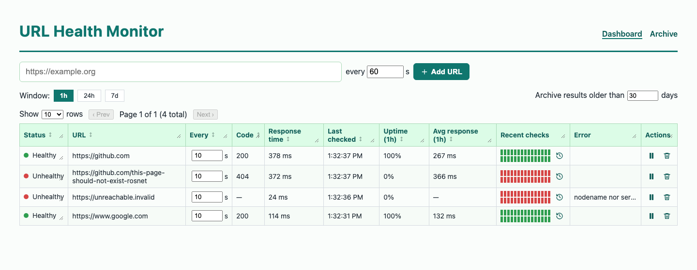

# URL Health Monitor

A small URL / service health monitor, built as a timed take-home for Rosnet. A C# backend checks
a list of URLs, each on its own schedule. It saves every result in SQLite. A React dashboard shows
which URLs are healthy right now and how each one has behaved over a chosen time window.



- **Decision log:** [`log.json`](log.json) holds every decision (D-001…D-031) with the
  alternatives and tradeoffs, every edge case (EC-001…EC-032), and notes on how AI was used.
- **Plain-English backend notes:** [`docs/CONCEPTS.md`](docs/CONCEPTS.md) explains each backend
  idea used here, with a JavaScript comparison.
- **The brief as given to the AI:** [`docs/KICKOFF_PROMPT.md`](docs/KICKOFF_PROMPT.md).

---

## How to run it

**Needs:** .NET 10 SDK and Node.js 20.19+ (or 22.12+).

```bash
dotnet run --project server
```

Open **http://localhost:5080**. That one command builds the React UI on a fresh clone
(`npm ci` + `vite build` into `server/wwwroot`) and serves both the UI and the API. The first run
creates `server/healthmonitor.db` and seeds four URLs, so you see every state at once:

| Seed | Shows |
|---|---|
| `https://example.com` | healthy |
| `https://github.com` | healthy, different interval |
| `https://github.com/this-page-should-not-exist-rosnet` | unhealthy with a status code (404) |
| `https://unreachable.invalid` | unhealthy with no response and an error reason (DNS; `.invalid` can never resolve) |

**Tests:** `dotnet test` (55 backend tests, ~1 s) and `npm --prefix web test` (8 frontend tests).
Backend line coverage is **91%**: `dotnet test --collect "Code Coverage;Format=cobertura"`.

**Frontend work with hot reload:** run `dotnet run --project server` in one terminal and
`npm --prefix web run dev` in another, then open the Vite address. `/api` is proxied to :5080.
After changing `web/src`, run `npm --prefix web run build` before a plain `dotnet run`, because
the build step only runs when `server/wwwroot` is missing (EC-014).

**Reset:** stop the app and delete `server/healthmonitor.db`.

---

## What I built

**Checks**
- One background loop (`BackgroundService` + `PeriodicTimer`, 5 s tick) finds every URL whose own
  interval has passed and checks it with a `GET`. It stops reading after the headers, so page
  bodies are never downloaded.
- **Healthy = status 200–399 within the 10 s timeout.** 4xx/5xx, timeouts, DNS failures and
  refused connections are recorded as **unhealthy**. When there is no response, the reason is saved.
- Checks run **concurrently, capped at 4**. The loop does not wait for a slow URL, so one URL that
  times out never delays the others (D-022). A URL that is still being checked is never started twice.

**History**
- Every check is its own row: URL id, UTC timestamp, status code (nullable), response time in ms,
  healthy flag, and error (nullable). Rows are only inserted, never updated.
- **Retention:** a global setting in the UI ("Archive results older than N days", default 30). A
  timer every 15 minutes moves older results into an archive table (see the deviation below).
- **Nothing is ever hard-deleted.** Removing a URL is a soft delete: it stops being checked and
  leaves the dashboard, but its history stays.

**Dashboard**
- One row per URL: status (colored dot **plus** a word, so it reads without color), last code, last
  response time, last checked, and uptime % and average response time over the selected
  **1h / 24h / 7d** window.
- A strip of the 30 newest checks, colored by result, with a tooltip on each box.
- The clock button opens a pop-up with that URL's **entire history**, sorted and paged.
- Add a URL with its interval. Change the interval in place (it applies on the next tick, with no
  restart). **Check now** (⚡) runs one check immediately. **Pause / play** a URL. **Remove** it with
  the trash can.
- Refreshes every 5 s without a page reload, plus a **Refresh** button. An **Auto-refresh** checkbox turns
  polling off, and it stops by itself while every URL is paused (the poll only reads; pausing is what stops checks).
- Server-side **sorting** on every column with an arrow, and **paging** with 10 / 50 / 100 rows.
- An **Archive** page lists every check ever saved: live and archived, removed URLs included. It
  has the same sorting and paging.
- Column widths and row heights can be dragged (CSS `resize`).

**Delivery:** one process serves the API and the built UI, so there is no CORS and no second
server. Every commit tells one step of the story (`git log --oneline`).

### API

| Method | Path | Purpose |
|---|---|---|
| GET | `/api/urls?window=1h\|24h\|7d&sort=&dir=&page=&pageSize=` | Dashboard rows: latest check + window summary + 30 newest checks |
| POST | `/api/urls` `{url, intervalSeconds}` | Add a URL (201) |
| PATCH | `/api/urls/{id}` `{intervalSeconds?, paused?}` | Re-time and/or pause/resume (204 / 404) |
| POST | `/api/urls/{id}/check` | Check now: run one check and return it (200 / 404) |
| DELETE | `/api/urls/{id}` | Soft delete (204 / 404) |
| GET | `/api/urls/{id}/checks?window=` | One URL's checks inside a window |
| GET | `/api/checks?sort=&dir=&page=&pageSize=&urlId=` | Every check, live + archived, paged |
| GET / PUT | `/api/settings` `{retentionDays}` | Read / change retention |

Bad input returns **400 with a reason**: URLs must be absolute http(s) and must not point to this
machine or the local network (SSRF guard), intervals must be 10 s–1 day (`InputRules.cs`, D-026),
and unknown windows, sort keys, directions or page sizes are refused. A sort key is looked up in a
fixed list, so client text never reaches the SQL (D-024).

### Data model (SQLite)

```
urls                  (id, url, interval_seconds, created_at, deleted_at?, paused_at?)
check_results         (id, url_id, checked_at, status_code?, response_time_ms, healthy, error?)
check_results_archive (same columns as check_results)
settings              (key, value)           -- retention_days
```

Times are ISO-8601 UTC text, which sorts correctly as text. "Last checked" is not stored on `urls`;
it is the newest result row. There are no migrations (D-005): the schema script runs at startup,
and missing columns are added to an older database once.

### Stack and why

| Choice | Why (full reasoning in `log.json`) |
|---|---|
| ASP.NET Core 10 Minimal APIs (D-001) | Rosnet is a .NET shop; Minimal APIs keep endpoints in one readable file |
| SQLite + Dapper (D-004, D-005) | Zero setup for a reviewer; plain SQL I can explain line by line, no ORM magic |
| `BackgroundService` + `PeriodicTimer` (D-006) | Built in; no job library needed for "check what is due every 5 s" |
| React 18 + Vite, plain JS and CSS (D-002, D-003) | Light dependencies, no TypeScript or UI kit to defend |
| **Packages added:** Dapper, Microsoft.Data.Sqlite; react, react-dom, vite, @vitejs/plugin-react; xunit, xunit.runner.visualstudio, Microsoft.NET.Test.Sdk, Microsoft.AspNetCore.Mvc.Testing | Each was approved before it was added (D-016, D-020, D-030). No icon, router, chart, or mocking libraries |

---

## Where I deviated from the brief

**Retention archives instead of deleting (D-023).** The brief says results older than the
retention period "are deleted on a timer". Partway through, I set a rule: no data is ever
hard-deleted, and full history must stay visible. So the timer *moves* old results from
`check_results` to `check_results_archive` in one transaction. The live table stays small, so the
dashboard queries stay fast, which is the practical point of retention. The Archive page still
shows everything. The cost is that the database only grows (EC-026). A real deployment would add a
purge or export job for the archive.

---

## Testing approach

Tests cover the **core requirements only**: a check gives the right result, results are saved, and
history can be read back. There are no edge-case tests (D-009, D-020). There is no mocking library:
a five-line fake `HttpMessageHandler` stands in for the network, and each database test uses its
own temporary SQLite file.

| Test | Proves |
|---|---|
| `Status_code_decides_healthy` (6 cases: 200, 301, 399, 400, 404, 500) | The 200–399 rule, including the exact boundary |
| `Response_time_covers_the_wait_for_the_server` | Response time is measured (the fake server waits 150 ms) |
| `Unreachable_url_is_unhealthy_with_the_reason` | No response → unhealthy, null code, reason saved |
| `Timeout_is_unhealthy_with_a_timeout_reason` | A timeout is unhealthy and says so |
| `Saved_check_is_still_there_after_a_restart` | Results persist; a restart does not re-seed |
| `History_window_returns_only_checks_inside_it` | The window filter, oldest first |
| `Window_summary_counts_uptime_and_average` | Uptime % and the average (which skips no-response checks, D-019) |
| `Retention_archives_old_results_without_losing_them` | Retention moves old rows out of the live table, and they are still listed |
| `Soft_delete_hides_the_url_but_keeps_its_history` | Remove hides the URL; its checks stay and are marked removed |
| `Pause_and_resume_flip_the_paused_flag` | Pause/resume sets the flag the scheduler reads |
| `Duplicate_check_ignores_case_and_trailing_slash_but_not_removed_urls` | The duplicate rule (409) |
| `All_checks_paging_returns_one_page_and_the_total` | Paging slice and total |
| `InputRulesTests` (24 cases) | Public URLs accepted; malformed URLs and every SSRF target refused; 172.32.x (just outside a private range) allowed; interval bounds 10 s–1 day |

| `CheckSchedulerTests` (3) | The real loop, started in-process: every due URL is checked and paused ones skipped; a recently checked URL is not re-checked; a URL that never answers does not hold up the others (CHK-05) |
| `RetentionSweeperTests` | The real timer service archives results older than the stored setting at start |
| `ApiTests` (14 cases) | The real app in memory (`WebApplicationFactory`, temp DB, background services off, fake network): page + sort, every 400 rule, add 201/409/400-with-reason, PATCH interval/pause, soft delete keeps history, check now, retention setting, one URL's window history |

**Coverage (backend, lines):** 91% overall: `Database.cs` 98%, `Program.cs` 92%, `UrlChecker.cs`
91%, `InputRules.cs` 89%, `CheckScheduler.cs` 80%, `RetentionSweeper.cs` 72%. What is left is mostly
the timer loop after its first pass and error-logging branches.

**Frontend (`web/src/logic.test.js`, Node's built-in test runner, no packages):** the UI's
decisions live in `web/src/logic.js` and are tested directly: sort toggling and arrows, page count
(never 0), row status (paused > pending > last result), a real 0% vs a missing value, and the
tooltip for a check with no response, and when the dashboard should keep polling.

**Each test can fail for a real reason.** I broke the code on purpose and watched the guarding test
fail: changing `<= 399` to `< 399` fails the 399 case, disabling the window filter fails the
history test, treating 0% as missing fails the frontend formatting test, ignoring pause or awaiting
checks one at a time fails the scheduler tests, and removing the duplicate check fails the API test.
(The first concurrency test passed against the broken loop because the hanging URL was last; that is
how it was found and fixed.)

**Checked by running the app, not by automated tests:** the fresh-clone build, real network checks
(including a local socket that never answers), and the UI layout (headless Chrome screenshots at
1280 / 1440 / 1920 px).

### What I didn't handle or test, and why

Edge cases were logged as they came up and not built during the main pass, so the core could
finish inside the cap. Nine are fixed: EC-001 (overlapping checks), EC-002 and EC-003 (server-side
interval and URL rules, including blocking internal addresses), EC-004 (duplicates → 409), EC-008
and EC-023 (deleting a URL with history), EC-009 (re-timing applies on the next tick), EC-011
(bodies are never downloaded), and EC-022 (a User-Agent is sent). The rest are deferred. The full list with descriptions is in
`log.json` → `edgeCases`.

| ID | Priority | Gap |
|---|---|---|
| EC-005 | 2 | Stored in UTC; shown in the browser's local time with no zone label |
| EC-006 | 2 | Expired or self-signed certificates are unhealthy, but the reason is the raw exception text, not a clear "certificate" message |
| EC-007 | 2 | Redirect loops rely on HttpClient's default redirect limit |
| EC-012 | 2 | A fresh clone needs Node installed; there is no friendly message if it is missing |
| EC-014 | 2 | `dotnet run` does not rebuild a stale `server/wwwroot` |
| EC-020 | 2 | On a fresh database, 1h / 24h / 7d look the same until history is older than an hour |
| EC-021 | 2 | The window summary re-reads every row in the window on each 5 s poll |
| EC-026 | 2 | Nothing is hard-deleted, so the database grows forever |
| EC-031 | 2 | The internal-address block checks the host as written; a public name that *resolves* to a private IP gets through |
| EC-010, 013, 015–019, 024, 025, 027–030 | 3 | Smaller gaps: possible SQLite write contention under heavy load, no undo for remove, OFFSET paging can shift rows, resized widths are not saved, retention days not validated on the server, polling continues in hidden tabs, and others |

Not tested on purpose: React component rendering (it would need Vitest + Testing Library + jsdom),
the scheduler's later ticks (tests run only its start-up pass), and the deferred edge cases above.

---

## What I cut, and what I'd do next

**Cut or changed**
- **Response-time sparkline (EXTRA-04): built, then removed.** Pause/resume (EXTRA-01), "check
  now" (EXTRA-02), and the per-URL history view (EXTRA-03) are in. The sparkline was built and then
  reverted after review: a moving line in every row was too much visual noise (D-029).
- **Hard-delete retention:** replaced by archiving (above).
- **Out of scope per the brief:** alerting, response-body assertions, retry/backoff, auth,
  multi-tenancy, containers, a design system, TypeScript, Postgres.

**Next steps, in order**
1. Finish input rules: retention days, and resolve-then-check for internal addresses (EC-030, EC-031).
2. Report TLS certificate errors clearly (EC-006).
3. A rollup table (per URL per hour) so 7-day stats don't re-scan raw rows (EC-021), plus a purge
   or export job for the archive (EC-026).
4. Keyset paging for the Archive (EC-028); restore a removed URL (EC-027).
5. Component tests (Vitest + Testing Library); pause polling when the tab is hidden (EC-018).
6. Alerting (email or webhook) when a URL changes state.

---

## How I used AI

This was built with Claude Code (Claude Opus) as a pair, using a lightweight plan → build → verify
loop. AI use is meant to be visible:
- Tests: 55 xUnit + 8 frontend (`node:test`).
- Every commit carries a `Co-Authored-By: Claude` trailer.
- Every decision in `log.json` has an `ai` block that says who suggested it and what I accepted,
  changed, or rejected.
- `log.json` → `aiNotes` records the AI's mistakes.

**What I rejected or changed**
- Claude recommended **TypeScript**. I rejected it for time and explainability (D-003).
- Claude wanted to trim scope (per-URL intervals, the extras). I kept them, but moved the extras to a
  stretch tier (D-008, D-012).
- Claude's planning workflow was eating the clock: about an hour before the first line of code. I
  cut it (D-015). Most work after Phase 1 was done directly in the session, with small commits.
- I overrode "delete on retention" with a no-hard-delete rule. Claude pointed out the conflict
  with the brief first and gave me options; I chose archiving (D-023).
- I directed the UI: soft delete, sorting/paging, icons, play/pause, the history modal, the layout,
  and the colors. I tried a blue header and reverted it (D-024, D-025).

**AI mistakes I caught or that were caught (all in `aiNotes`)**
- An AI code reviewer's warning about the database path was partly wrong. I checked it before acting.
- Claude's own `.csproj` edit broke the XML; a rebuild caught it before the commit.
- A Claude test script killed my running app on port 5080. All later checks used a separate port
  and a copy of the database.
- A first Python edit script broke on C# raw strings and left a file half-edited; the build caught
  it.
- Claude shipped two UI rounds without looking at them, and the table overflowed the screen. After
  that, every UI change was checked with headless-browser screenshots.

**How I made sure I can own the code**
- Small files, no interfaces or layers "for later", and comments that say *why*.
- Every new backend idea is explained in `docs/CONCEPTS.md`, in simple English, with a JavaScript
  comparison.

---

## Repo map

```
server/            ASP.NET Core app (API, scheduler, retention, SQLite)
  Program.cs         endpoints, paging rules, DI setup
  Database.cs        schema, seeds, all SQL (Dapper)
  UrlChecker.cs      one check: GET, timing, healthy rule
  CheckScheduler.cs  5 s loop, concurrency cap, pause
  RetentionSweeper.cs moves old results to the archive
web/src/           React 18 UI (plain JS + CSS)
tests/             xUnit tests (55); frontend tests are in web/src/logic.test.js
docs/              CONCEPTS.md, KICKOFF_PROMPT.md, screenshot
log.json           decisions, edge cases, AI notes, timebox
.planning/         plan/state files from the AI workflow
```

## Time

**Build time: 1h 52m 34s of the 3-hour cap.** Recorded in `log.json` → `timebox`, and checkable
from the commit timestamps (`TZ=UTC git log --date=iso-strict-local`):

| Moment | UTC | Commit |
|---|---|---|
| Build clock starts (first line of app code) | 18:05:44 | `0937bda` at 18:06:00 |
| Core complete (every v1 requirement + README) | 19:34:01 | `99a6f75` |
| Last app or test code | 19:58:18 | `e5efa1d` |

Planning before the clock (requirements, roadmap, process setup) is not counted, per the timebox
rule. After 19:58 only docs changed: this section, CONCEPTS.md, and a final fresh-clone check
(clone → `dotnet run` → UI served in 6 s, all tests pass).
